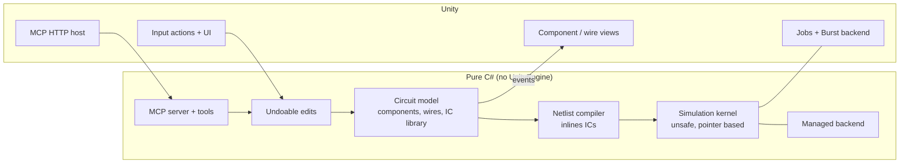

# LogicSim

A digital logic simulator built with Unity 6. Place gates, wire them up, flip switches and watch signals propagate.
Build your own integrated circuits from smaller ones, compute truth tables, and let an AI agent design and test
circuits through the built-in **MCP server**.


## Features

- **Components:** AND, OR, NOT, NAND, NOR, XOR, XNOR, Buffer (1–8 inputs), switch, push button, clock, constant,
  bulb, hex display, D / T / JK flip-flops, input/output pins.
- **Custom ICs:** turn any circuit (or a selection) into a reusable component. Switches, buttons and input pins
  become its inputs; bulbs and output pins become its outputs. ICs can nest.
- **Editor:**
  - drag and drop from the palette
  - pin-to-pin wiring with orthogonal routing
  - rewire or disconnect by dragging an input
  - box and shift selection, move, rotate
  - cut / copy / paste, including between app instances through the system clipboard
  - unlimited undo/redo for every edit
- **Simulation:**
  - unit-delay model: every gate needs one tick, so glitches, latches and ring oscillators behave like real logic
  - pause, single-step and adjustable speed (1 to 10M ticks/s)
  - wires are colored by their signal
- **Analysis:** truth tables for any combinational circuit (up to 12 inputs).
- **Files:** JSON documents with embedded IC definitions, plus bundled examples (half/full adder, SR latch,
  4-bit counter, 4-bit adder built from IC instances).
- **AI agents (MCP):** 27 tools to build, edit, simulate and analyse circuits, available inside the running app and as a
  headless server.

## Architecture



- **Model first.** The `Circuit` model is the single source of truth. Mouse, keyboard, toolbar and MCP all change it
  through `ICircuitEdit` objects, which the app puts on its undo stack. Views only react to model events.
- **Engine independent.** The model, compiler, simulation kernel, file format and MCP server are plain C#
  (`noEngineReferences`). The same sources build as a .NET Standard 2.1 library for the tests, the CI and the
  headless MCP server.
- **One kernel, several backends.** `SimulationKernel` works on raw pointers to a structure-of-arrays netlist. The
  managed backend runs it on pinned arrays. The Unity backend runs the same code in Burst-compiled jobs. Parity tests
  compare the backends on random circuits tick by tick.

### Simulation engine

The compiler flattens the circuit into a netlist:
- each output pin becomes a net,
- each primitive becomes a gate with an opcode,
- IC boundaries become net aliases, so ICs add no delay.

Simulation is two-valued and **unit-delay**.

- **Event-driven mode:** only gates whose inputs changed in the previous tick are evaluated. When nothing is pending,
  the engine jumps straight to the next clock edge, so an idle circuit costs nothing.
- **Full-sweep mode:** every gate is evaluated each tick into a second buffer. This mode is split across all CPU cores
  with `IJobParallelFor`. It is used automatically for very large circuits with high activity (≥ 40k gates, ≥ 20 % of
  them active per tick).
- **Frame scheduling:** in the app, each frame's ticks run in a single worker job scheduled in `LateUpdate`, so the
  simulation overlaps with rendering. The job is collected at the start of the next frame.

Managed backend, single thread, Intel Xeon 2.8 GHz (`dotnet run --project Headless/LogicSim.Benchmark -c Release`):

| Circuit | Gates | Event-driven | Full sweep |
|---|---:|---:|---:|
| 64 × 32-bit ripple adders, inputs toggled | 14,336 | 735k ticks/s | 6.7k ticks/s |
| Random feedback circuit (always active) | 10,032 | 11.3k ticks/s | 4.5k ticks/s |
| Random feedback circuit (always active) | 200,064 | 179 ticks/s | 213 ticks/s |

The Jobs + Burst numbers depend on the machine. Measure them in the editor with **Tools > LogicSim > Run Simulation
Benchmark**.

## Controls

| Action | Input |
|---|---|
| Place a component | Drag it from the palette |
| Wire | Drag from a pin to a pin; drop on a connected input to rewire it |
| Disconnect | Drag a connected input onto empty canvas, or select the wire and press Del |
| Select | Click, Shift+click, or drag on empty canvas |
| Pan / zoom | Middle mouse or Alt+drag / mouse wheel |
| Paste position | Right click |
| Undo / redo | Ctrl+Z / Ctrl+Y (or Ctrl+R) |
| Cut / copy / paste / delete | Ctrl+X / Ctrl+C / Ctrl+V / Del |
| Rotate / select all / frame circuit | R / Ctrl+A / F |
| New / open / save | Ctrl+N / Ctrl+O / Ctrl+S |
| Start / stop the simulation | F5 or the play button |
| Pause / step one tick / speed | P / . / [ and ] |
| Help | F1 |

In simulation mode, click switches and input pins to toggle them, and hold push buttons.

## MCP (Model Context Protocol)

The app runs an MCP server at `http://127.0.0.1:8765/mcp` (Streamable HTTP, loopback only). Agents see and change
the live circuit; their edits are undoable like your own.

```sh
# Claude Code
claude mcp add --transport http logicsim http://127.0.0.1:8765/mcp
```

Clients that only support stdio can use a bridge such as
`npx mcp-remote http://127.0.0.1:8765/mcp`. Without Unity, the headless server provides the same tools:

```sh
dotnet run --project Headless/LogicSim.McpServer                 # stdio
dotnet run --project Headless/LogicSim.McpServer -- --http 8765  # HTTP
```

Tools include:
- `build_circuit`: components and connections in one call, with automatic layout
- `connect`, `set_inputs`, `run_simulation`, `read_signals`
- `truth_table`, `create_subcircuit`
- `save_circuit` / `load_circuit`, `undo` / `redo`, `get_selection`
- and more; `tools/list` returns the full list with JSON schemas.

Example request an agent can send:

```json
{
  "name": "build_circuit",
  "arguments": {
    "clear": true,
    "components": [
      { "type": "Switch", "label": "A" }, { "type": "Switch", "label": "B" },
      { "key": "x", "type": "Xor" }, { "key": "c", "type": "And" },
      { "type": "Bulb", "label": "Sum" }, { "type": "Bulb", "label": "Carry" }
    ],
    "connections": [["A", "x"], ["B", "x"], ["A", "c"], ["B", "c"], ["x", "Sum"], ["c", "Carry"]]
  }
}
```

The MCP port and on/off switch are in `Settings.json` in the player's persistent data folder (`McpEnabled`,
`McpPort`). The server is not available in WebGL builds.

## Project layout

```
Assets/Scripts/
  Simulation/        model, editing, compiler, kernel, managed backend, file format, truth tables (pure C#)
  Simulation.Jobs/   Unity Job System + Burst backend
  Mcp/               MCP protocol, tools, stdio and HTTP transports (pure C#)
  Core/              app services: settings, input, undo/redo, selection, document, simulation loop
  App/               bootstrap, simulation driver, MCP host for the running app
  Views/             component, pin and wire views
  Actions/           mouse and keyboard interaction
  UI/                toolbar, palette, dialogs, status bar
Assets/Tests/EditMode/   NUnit tests (Unity Test Runner and dotnet)
Headless/            .NET solution: core library, MCP server, tests, benchmark
```

## Building and testing

- **Unity:** open the project with Unity 6000.4. Burst is optional; without it, the Jobs backend runs as managed jobs.
- **Tests without Unity:** `dotnet test Headless/LogicSim.Headless.sln`. This covers 56 core/MCP tests plus the Jobs
  backend run against a functional stand-in of the Unity job API. The same EditMode tests appear in Unity's Test
  Runner.
- **CI:** GitHub Actions builds and tests the headless solution on every push.

## Simulation model notes

- Unconnected inputs read 0.
- An input accepts one driver. Outputs can fan out to any number of inputs.
- Flip-flops start with Q = 0. Power-on does not produce spurious clock edges.
- A NOR or NAND latch whose inputs are both inactive at power-on oscillates symmetrically, as an ideal unit-delay
  circuit should, until one input is pulsed.
